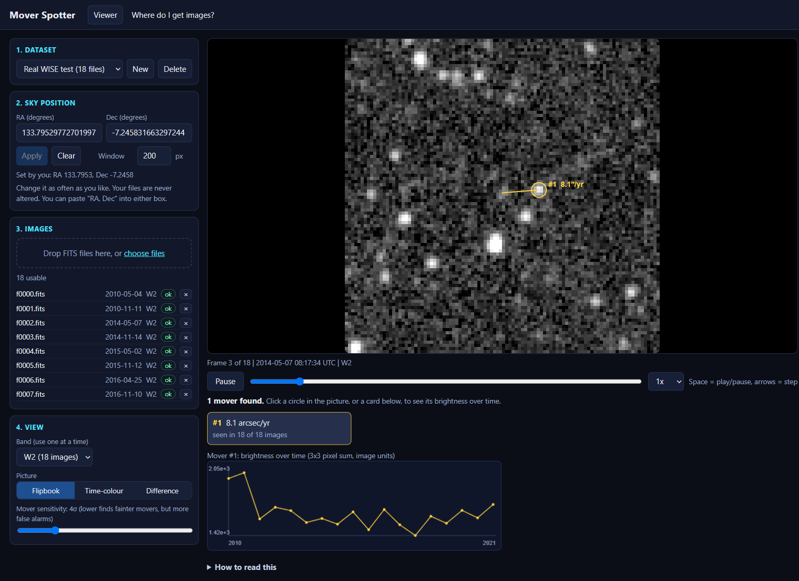
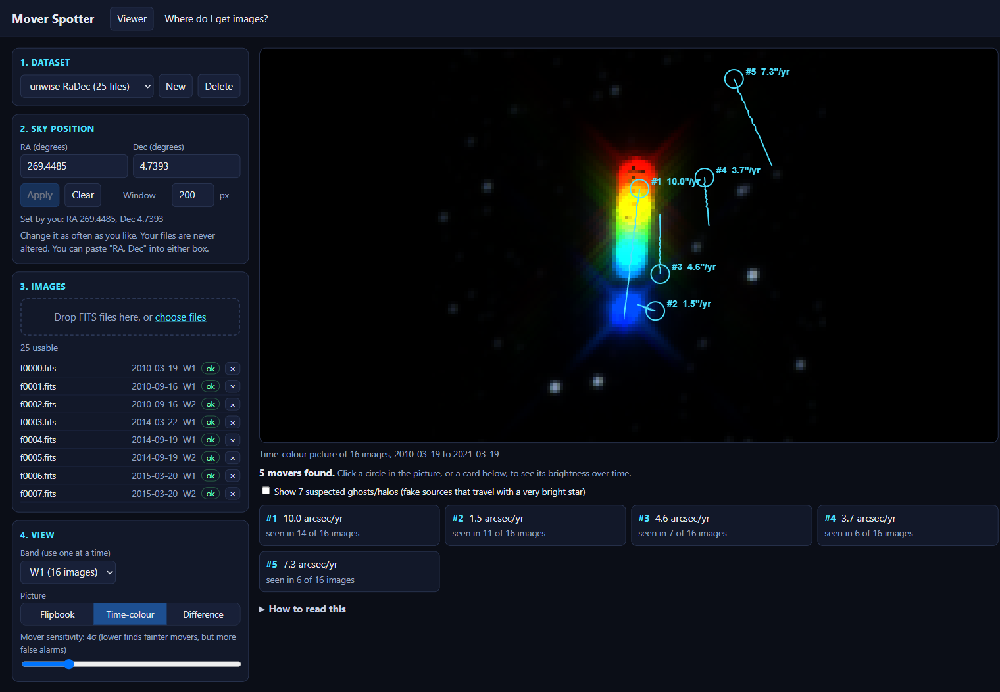

# Mover Spotter

NASA Space Apps 2026, "Planet X and SPHEREx". Upload a series of sky images taken on different dates; the app plays them
like a flipbook and automatically circles objects that move (brown dwarfs, nearby stars, asteroids, comets).

Nothing about targets is built in: no preset objects, no hardcoded coordinates. You upload FITS images, the app reads the sky
coordinates, date and band from each header, and everything else is computed from the data.


*18 real WISE epochs (2010-2021): the circled object moves 8.1 arcsec/yr while the stars stay put.*


*Time-colour view of Barnard's Star, 16 WISE W1 epochs: blue = 2010, red = 2021.*

## Run it
```
python -m venv .venv
.venv\Scripts\python -m pip install -r requirements.txt
cd frontend && npm install && npm run build && cd ..          # builds the React app into frontend/dist
.venv\Scripts\python -m uvicorn backend.app:app --port 8000     # open http://localhost:8000
.venv\Scripts\python -m pytest -q tests
```
Front-end development with hot reload: run the Python server as above, then `cd frontend && npm run dev` (port 5173, proxies /api).

## Use it
1. **New** dataset (just a name).
2. **Sky position**: RA/Dec in degrees. Needed for big images (e.g. full WISE tiles), which are cropped around it; optional for small
   cutouts. **Change it or Clear it any time**: nothing is re-uploaded and the original files are never altered.
3. Drag FITS files into **Images**. Each file is listed as ok / needs RA/Dec / outside position, with a button to remove it.
4. Pick a band and a picture. Everything updates by itself:
   - **Flipbook**: play through time (space = play/pause, arrows = step), circles + trails on movers, click one for its brightness curve.
   - **Time-colour**: all dates stacked, one colour per date. Stars white, movers leave rainbow trails.
   - **Difference**: newest third minus oldest third. A mover is blue where it was, red where it is.

The **Where do I get images?** tab explains how to download images by hand in a browser, no scripts needed.
Optional command-line helpers in `scripts/`: `fetch_unwise_epochs.py` (WISE epochs), `find_images.py` + `download_cutouts.py`
(SPHEREx via IRSA), `resolve_targets.py` (name -> coordinates via MAST), `upload_folder.py` (send a folder of FITS files to a running server).

## How it works
- `backend/store.py`: datasets in `data/uploads/` (gitignored). Original files are kept untouched; sky coordinates, date (MJD-OBS / MJDMEAN /
  MJDMIN+MJDMAX / DATE-OBS) and band (DETECTOR / BAND / FILTER / file name) are read from headers; big images are cropped on demand around
  the chosen RA/Dec; draws flipbook, time-colour and difference pictures.
- `backend/movers.py`: Mover Spotter. Detect sources in each frame, link detections into straight-line tracks over time,
  remove each frame's pointing shift using the static stars, keep tracks with real motion. Match radius, minimum motion and speed limit
  come from the data's pixel scale and time span. A track must appear in enough frames that a chance alignment is unlikely (computed from the
  source density and the number of lines tried). Fake sources that travel with a very bright star (halo, optical ghost) are flagged and hidden
  by default. Sensitivity (sigma) is a slider.
- `backend/app.py`: FastAPI endpoints under `/api/datasets/...` (also serves the built front end). `frontend/`: React + Vite.

## Results so far
- Real data: 18 WISE W2 epochs of a known fast brown dwarf. With default settings Mover Spotter finds exactly one mover,
  8.1 arcsec/yr, present in 18/18 frames, which matches the published proper motion (~8.1 arcsec/yr).
- Barnard's Star (W2): one mover, 10.1 arcsec/yr in 9/9 frames; its fake halo/ghost sources are flagged.
- 9 automated tests (synthetic movers, halo/ghost flagging, upload errors, RA/Dec set/change/clear, cropping, API).

## Limits
- SPHEREx data was not tested: IRSA's search service (TAP) was down during development. The app accepts SPHEREx cutouts
  (`IMAGE` extension, `DETECTOR`, `MJD-OBS`) but this path is untested on real files.
- Needs at least 5 images in one band. A mover closer than ~2 pixels to a bright star blends with it and is missed.
- Use one band at a time; different bands show different stars.
- Fields with a very bright star can still leave a few faint false movers near it (seen in Barnard's Star W1).
- Datasets uploaded with the first version stored already-cropped copies; re-upload the original files to be able to re-centre them freely.
- Data: WISE/unWISE time-resolved coadds (NERSC), NASA/IPAC IRSA for SPHEREx. Acknowledge them when using the data.
