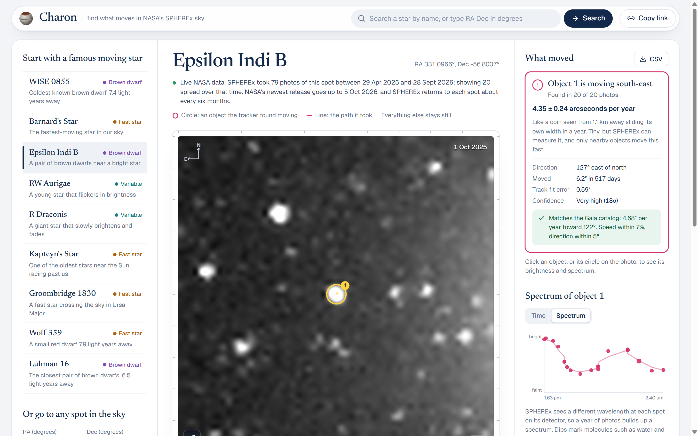
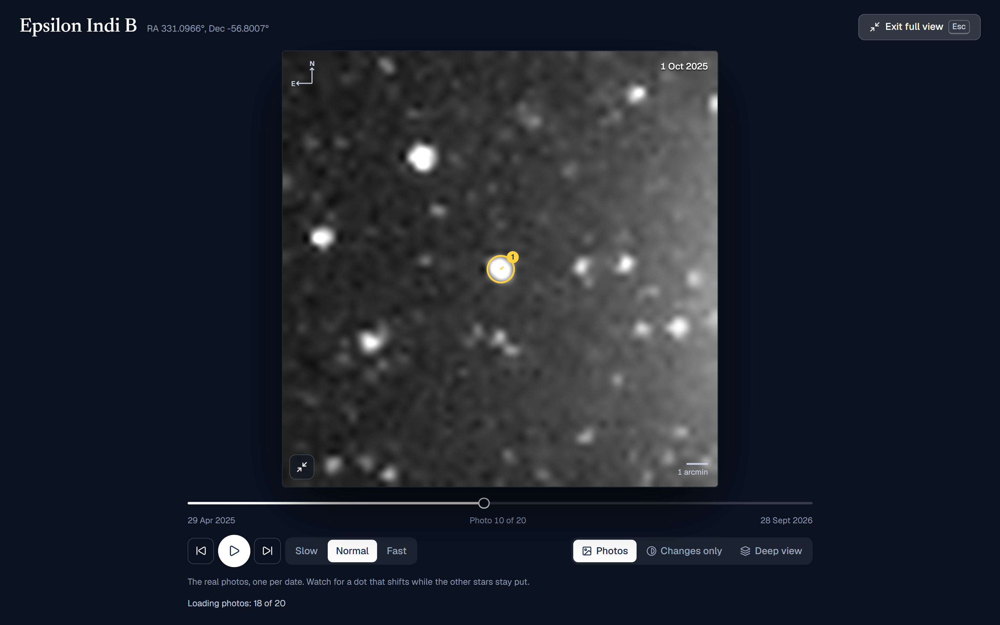
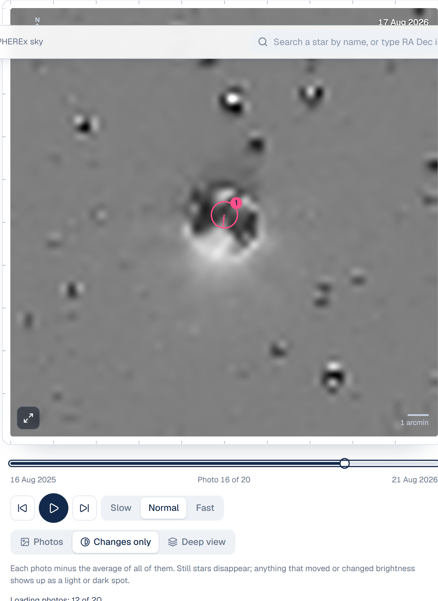
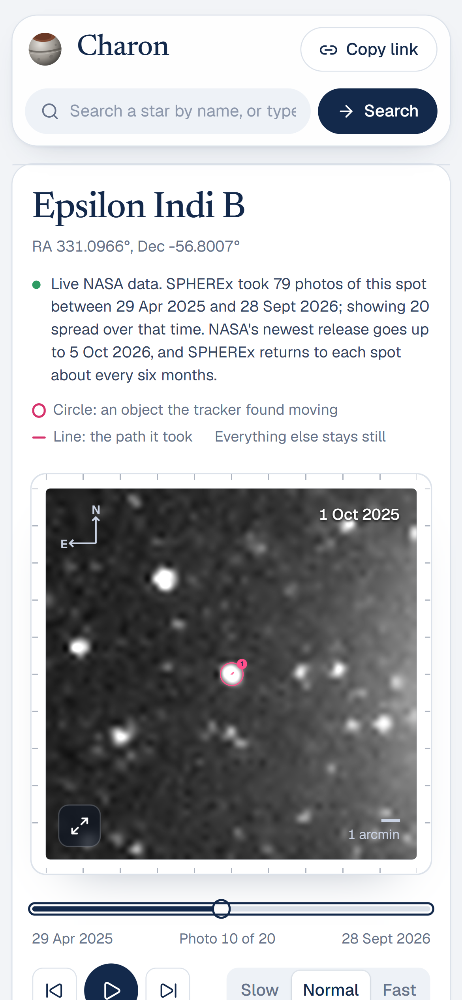

# Charon

**Find what moves in NASA's SPHEREx sky.**
Pick any spot in the sky, watch a year of real SPHEREx infrared photos of it as a flip-book, and let Charon find, measure and verify the objects that move.

Built for the NASA Space Apps Challenge 2026, challenge "Planet X and SPHEREx".

| | |
| --- | --- |
| **Live app** | [nasa-space-apps-challenge-ten.vercel.app](https://nasa-space-apps-challenge-ten.vercel.app) |
| **Demo video (30 s)** | [docs/charon_demo.mp4](docs/charon_demo.mp4) |
| **Code** | [github.com/Umar-Farooq-2112/nasa-space-apps-challenge](https://github.com/Umar-Farooq-2112/nasa-space-apps-challenge) |



*Epsilon Indi B, a brown dwarf 12 light-years away, found in 20 SPHEREx photos taken between April 2025 and September 2026.
Charon measures 4.35 ± 0.24 arcseconds per year toward 127°, within 7% and 5° of the Gaia catalog, and builds its spectrum from the photos.*

## Why the name

In 1978 James Christy noticed a small bump on Pluto's image that moved from one photo to the next.
It was Charon, Pluto's largest moon.
This app does the same thing at sky scale: line up photos taken months apart and look for the dot that moved.

## What it does

- **Any spot in the sky.** Search a star by name (positions corrected for proper motion to 2026) or type RA and Dec, or start from nine famous moving stars and brown dwarfs.
- **A year as a movie.** Up to 20 SPHEREx photos spread over the whole time range, aligned north-up so still stars stay put and movers visibly shift.
- **Three ways to look.** *Photos* as NASA took them, *Changes only* (each photo minus the average sky, so still stars vanish) and *Deep view* (all photos stacked, about 3.5 times less noise).
- **Automatic mover detection.** Each moving object is circled and its path drawn, with speed, direction, error bar, confidence and an everyday comparison ("like a coin seen from 1.1 km away sliding its own width in a year").
- **Checked against Gaia.** When the mover is a known star, its measured motion is compared with the ESA Gaia catalog via SIMBAD.
- **Brightness and spectrum.** SPHEREx sees a slightly different wavelength in every photo, so a year of photos gives each mover a spectrum, which shows whether it is a cold brown dwarf.
- **All six infrared detectors** (0.75 to 5.0 micrometres), three field sizes, a random-spot explorer and full-screen view.
- **Open and shareable.** Every view has a link, every photo can be downloaded as the original FITS file, and every measurement can be exported as CSV.
- **Always current.** Uses NASA's newest public SPHEREx release (currently up to 5 October 2026) and downloads new photos live for any spot.

## Screenshots

| Full view | Changes only |
| --- | --- |
|  |  |

| First visit | Phone |
| --- | --- |
|  |  |

## Results on real SPHEREx data

20 photos per target, about a year apart from first to last, detector D3 unless noted.

| Target | Charon measured | Gaia catalog | Verdict |
| --- | --- | --- | --- |
| Barnard's Star | 8.7″/yr toward 351° | 10.4″/yr toward 356° | found |
| Epsilon Indi B | 4.35 ± 0.24″/yr toward 127° | 4.7″/yr toward 122° | found, within 7% |
| Kapteyn's Star | 9.1″/yr toward 131° | 8.6″/yr toward 131° | found, within 5% |
| Groombridge 1830 | 5.7″/yr toward 157° | 7.1″/yr toward 146° | found |
| Luhman 16 | 3.1″/yr toward 271° | 2.8″/yr toward 277° | found |
| Wolf 359 (fetched live, never cached) | 5.3″/yr toward 244° | 4.7″/yr toward 235° | found |
| RW Aurigae, R Draconis (variable stars) | no movers | about 0.02″/yr | correct |
| WISE 0855 (D6) | visible in the movie, too faint to track in single photos | 8.1″/yr | next step: track on stacked photos |

The spectrum of Epsilon Indi B shows the water and methane dip near 1.8 to 1.95 micrometres that marks a cold brown dwarf.

## How it works

1. **Find the photos.** NASA's SPHEREx search service was down during the hackathon, so Charon has its own index of every SPHEREx image (about 270,000 per detector), built from IRSA's public copy on AWS by reading only the pointing data in each image header.
   A whole-sky search takes under a second, and re-running the index picks up each new weekly release.
2. **Download small cutouts.** For a new spot, up to 20 cutouts are cut from NASA's 65 MB images by IRSA's cutout service and cached, so the next visit is instant.
3. **Align.** Every photo is resampled onto a common north-up grid using its own sky coordinates (WCS); bad pixels are filled from their neighbours using the SPHEREx quality flags.
4. **Track.** Sources are found in every photo, small pointing shifts are removed using the stars that stay still, and sources are linked into straight-line tracks over time.
   Only tracks that really move are kept, each with a fitted speed, direction and error.
5. **Measure.** Brightness comes from aperture photometry, and the wavelength of each measurement from the SPHEREx spectral map (WCS-WAVE), which gives the spectrum.

## Tech

- **Backend:** Python, FastAPI, Astropy, NumPy, SciPy, Pillow, SQLite (`backend/`).
- **Frontend:** React 19, TypeScript and Vite, no UI framework (`web/`).
  `npm run build` writes to `public/`.
- **Hosting:** Vercel.
  The page is served from the CDN; the API runs as a Python function, with the compact sky index and the nine example targets shipped in `seed/`.
- **CI:** GitHub Actions runs the backend tests and type-checks and builds the frontend on every push.
  Every push to `main` deploys to Vercel.

## Run it locally

```bat
python -m venv .venv
.venv\Scripts\python -m pip install -r requirements.txt
.venv\Scripts\python -m uvicorn backend.app:app --port 8000
```

Open <http://localhost:8000>.
The app works out of the box with the shipped index and example targets.

```bat
.venv\Scripts\python -m pytest -q tests                   & REM backend tests (offline)
cd web && npm ci && npm run dev                           & REM frontend dev server, proxies /api to port 8000
cd web && npm run build                                   & REM rebuild public/
.venv\Scripts\python -m backend.sky_index D3              & REM rebuild the full image index from AWS (resumable)
.venv\Scripts\python -m scripts.make_seed                 & REM refresh seed/ for deployment
```

Share or embed a view with URL parameters, for example `/?ra=331.0966&dec=-56.8007&fov=0.1&detector=D3&mode=diff`.

## Project layout

| Path | What it is |
| --- | --- |
| `backend/app.py` | API: `/api/frames`, `/api/frame.png`, `/api/frame.fits`, `/api/movers`, `/api/resolve`, `/api/targets` |
| `backend/sky_index.py` | Our SPHEREx image index built from the AWS bucket |
| `backend/irsa.py` | Live cutout downloads from NASA IRSA |
| `backend/cutouts.py` | Alignment, cleaning and image rendering (photos, changes only, deep view) |
| `backend/movers.py` | The moving-object tracker |
| `backend/resolve.py` | Star name lookup with proper motion |
| `web/` | React frontend source |
| `public/` | Built frontend, served by Vercel's CDN |
| `seed/` | Compact index and example cutouts shipped with the deployment |
| `tests/` | Backend tests |
| `docs/` | Demo video, screenshots and the Space Apps submission text |

## Limits

- Very faint movers such as WISE 0855 are visible in the movie but too faint to track in single photos; tracking on stacked photos (shift-and-stack) is the next step.
- Very crowded Milky Way fields (for example Proxima Centauri) confuse the tracker.
- Brightness values mix wavelengths, so they are indicative rather than calibrated.
- SPHEREx pixels are 6.15 arcseconds wide, so photos are smoothly upscaled for display; they show what the telescope saw, not more.
- On Vercel's free plan, the first request after a quiet period takes up to about 20 seconds while the server starts.

## Credits

- Images: NASA SPHEREx (JPL/Caltech), from the NASA/IPAC Infrared Science Archive (IRSA) and its open copy on AWS.
- Star positions and motions: ESA Gaia via SIMBAD and the CDS Sesame name resolver.
- Fonts: Newsreader and Geist (SIL Open Font License).
- Built with help from AI coding tools (Claude Code); the demo voice-over uses neural text-to-speech.
