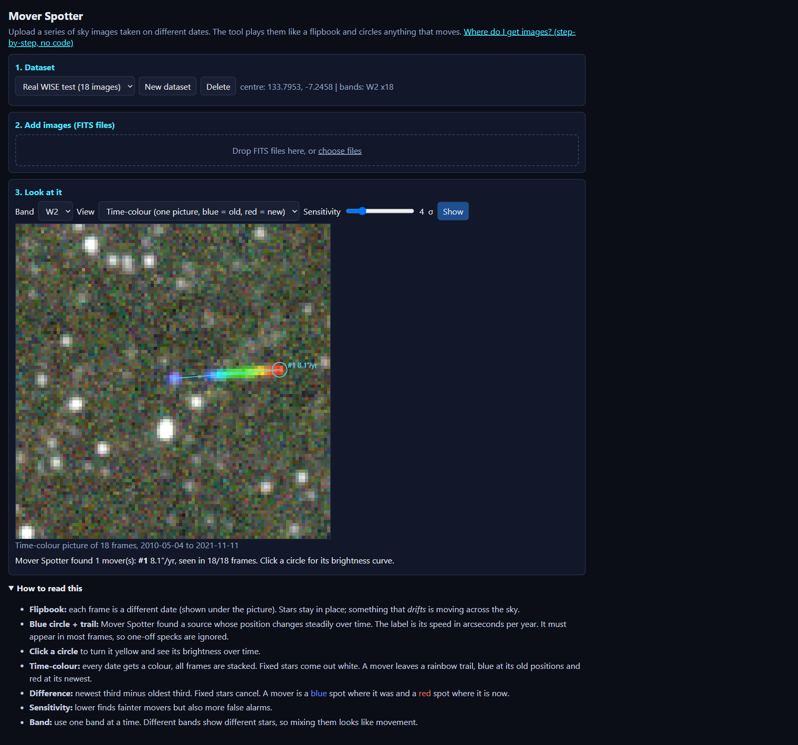

# Mover Spotter

NASA Space Apps 2026, "Planet X and SPHEREx". Upload a series of sky images taken on different dates; the app plays them
like a flipbook and automatically circles objects that move (brown dwarfs, nearby stars, asteroids, comets).

Nothing about targets is built in: no preset objects, no hardcoded coordinates. You upload FITS images, the app reads the sky
coordinates, date and band from each header, and everything else is computed from the data.


*Time-colour view of 18 real WISE epochs (2010-2021). Fixed stars are white; the one mover leaves a blue-to-red trail.*

## Run it
```
python -m venv .venv
.venv\Scripts\python -m pip install -r requirements.txt
.venv\Scripts\python -m uvicorn backend.app:app --port 8000      # open http://localhost:8000
.venv\Scripts\python -m pytest -q tests
```

## Use it
1. **New dataset** (give RA/Dec only if your images are big, e.g. full WISE tiles; they are cropped around that point).
2. Drag FITS files into the page. Each file is reported OK, or skipped with a plain-English reason.
3. Pick a band, a view and press **Show**:
   - **Flipbook**: play through time, circles + trails on movers, click a circle for its brightness curve.
   - **Time-colour**: all dates stacked, one colour per date. Stars white, movers leave rainbow trails.
   - **Difference**: newest third minus oldest third. A mover is blue where it was, red where it is.

`frontend/guide.html` (link on the main page) explains how to download images by hand in a browser. No scripts needed.
Optional helper scripts in `scripts/` do the same from the command line: `fetch_unwise_epochs.py` (WISE epochs),
`find_images.py` + `download_cutouts.py` (SPHEREx via IRSA), `resolve_targets.py` (name -> coordinates via MAST),
`upload_folder.py` (send a folder of FITS files to a running server).

## How it works
- `backend/store.py`: datasets in `data/uploads/` (gitignored). Reads WCS, date (MJD-OBS / MJDMEAN / MJDMIN+MJDMAX / DATE-OBS)
  and band (DETECTOR / BAND / FILTER / file name) from headers; crops large images; draws flipbook, time-colour and difference pictures.
- `backend/movers.py`: Mover Spotter. Detect sources in each frame, link detections into straight-line tracks over time,
  remove each frame's pointing shift using the static stars, keep tracks with real motion. Match radius, minimum motion and speed limit
  come from the data's pixel scale and time span. Sensitivity (sigma) is a slider.
- `backend/app.py`: FastAPI endpoints under `/api/datasets/...`. `frontend/`: plain HTML/JS.

## Results so far
- Real data: 18 WISE W2 epochs of a known fast brown dwarf. With default settings Mover Spotter finds exactly one mover,
  8.1 arcsec/yr, present in 18/18 frames, which matches the published proper motion (~8.1 arcsec/yr).
- 8 automated tests (synthetic movers, upload errors, cropping, API).

## Limits
- SPHEREx data was not tested: IRSA's search service (TAP) was down during development. The app accepts SPHEREx cutouts
  (`IMAGE` extension, `DETECTOR`, `MJD-OBS`) but this path is untested on real files.
- Needs at least 5 images in one band. A mover closer than ~2 pixels to a bright star blends with it and is missed.
- Use one band at a time; different bands show different stars.
- Data: WISE/unWISE time-resolved coadds (NERSC), NASA/IPAC IRSA for SPHEREx. Acknowledge them when using the data.
