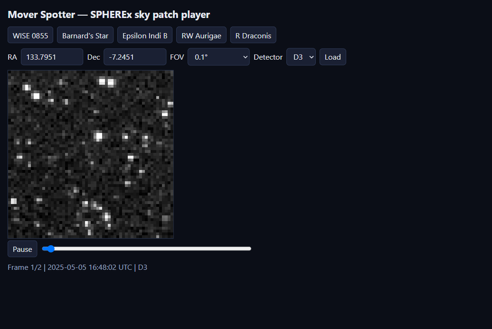

# Mover Spotter

NASA Space Apps 2026 challenge "Planet X and SPHEREx". A web tool that shows SPHEREx images of a sky patch
as a short movie and automatically circles objects that move between frames (brown dwarfs, asteroids, comets).



## Quick start
```
python -m venv .venv
.venv\Scripts\python -m pip install -r requirements.txt
.venv\Scripts\python -m uvicorn backend.app:app --port 8000      # open http://localhost:8000
.venv\Scripts\python -m pytest -q tests                          # synthetic mover tests
```
Share a view with URL parameters: `/?ra=133.7951&dec=-7.2451&fov=0.1&detector=D3`

## How it works
- `scripts/` get data from NASA IRSA: `find_images.py` (TAP query: which images cover a position),
  `download_cutouts.py` (small FITS cutouts, ~4 MB each), `fits_to_png.py`, `fetch_all.py` (all 5 demo targets).
- `backend/` FastAPI: `/api/frames`, `/api/frame.png`, `/api/movers`, `/api/targets`.
- `backend/movers.py` Mover Spotter: detect sources, link them into straight-line tracks over time,
  remove each frame's pointing shift using static stars, keep tracks that really move. Tested on synthetic data.
- `frontend/index.html` player with presets, play/pause, slider, dates, URL params, circles, trails, click a mover for its light curve.

## Status
Working: player, API, Mover Spotter on synthetic data.
Not yet: live fetching from IRSA inside the app (data must be in `data/raw/cutouts/` first, via `scripts/`),
FOV selector (cutouts are fixed at 0.1 deg), tests on real movers (IRSA's TAP search was down while building;
only 12 mixed-detector cutouts of WISE 0855 were downloaded).

## Notes
- Use ONE detector (D1-D6) per movie: each sees a different wavelength, so frames from different detectors are not comparable.
- A mover closer than ~2 pixels to a bright star blends with it and is missed.
- Raw data and frames are gitignored (`data/raw`, `data/frames`); re-create with `scripts/`.
- Data: NASA/IPAC IRSA, SPHEREx DR1. Acknowledge SPHEREx (JPL/Caltech, NASA) when using the data.
