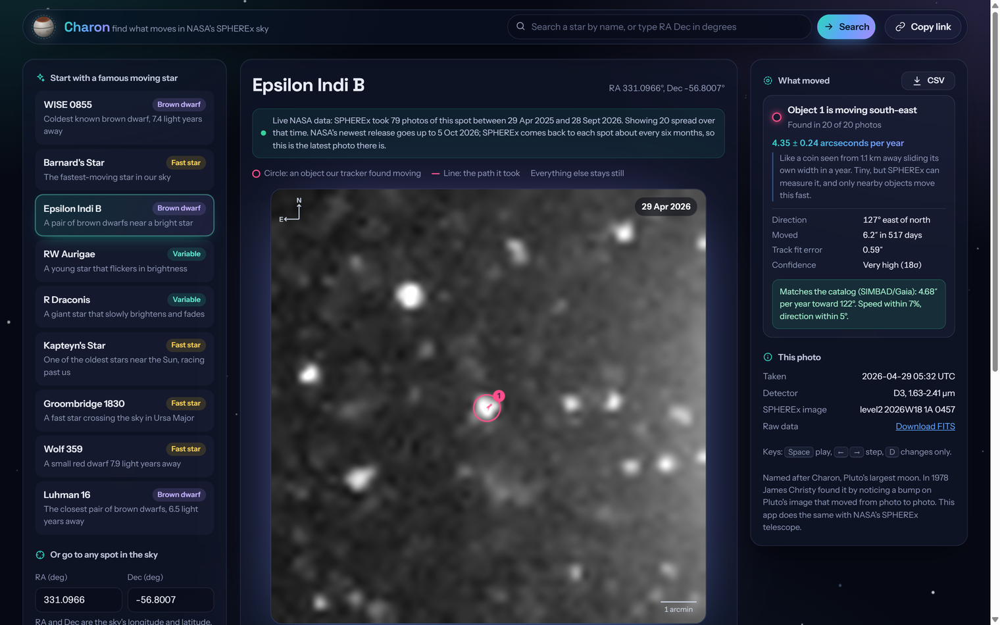

# Charon

NASA Space Apps 2026 challenge "Planet X and SPHEREx".
Named after Charon, the moon of Pluto found in 1978 when a bump on Pluto's image was seen to move between photos.
A web tool that shows SPHEREx images of a sky patch as a short movie and automatically circles objects that move between frames (brown dwarfs, asteroids, comets).



Live app: https://nasa-space-apps-challenge-ten.vercel.app

Demo video (30 s): [docs/charon_demo.mp4](docs/charon_demo.mp4)

## Features

- Search any star by name (CDS Sesame, corrected for proper motion to 2026) or type RA/Dec.
- A year of SPHEREx images of that spot, aligned north-up, played as a movie with speed control and keyboard keys.
- "Changes only" mode: each image minus the median sky, so still stars vanish and movers stand out.
- "Deep view": all images stacked (median), about 3.5x less noise, so faint objects appear. Images are upscaled smoothly (bicubic) instead of as blocky pixels.
- Shows how fresh the data is: the newest NASA release in the index (currently up to 5 Oct 2026) and the newest photo of the chosen spot.
- Moving-object tracker: finds and circles moving objects, draws their path, reports speed and direction, and plots their brightness.
- All six SPHEREx detectors (0.75 to 5.0 µm) on a wavelength strip; cold brown dwarfs like WISE 0855 only show up at the long end.
- Field of view 3, 6 or 12 arcmin; shareable links that restore the exact view; raw FITS download for every image.
- Nine presets: the five challenge targets plus Kapteyn's Star, Groombridge 1830, Wolf 359 and Luhman 16.

## Quick start

```bat
python -m venv .venv
.venv\Scripts\python -m pip install -r requirements.txt
.venv\Scripts\python -m uvicorn backend.app:app --port 8000      & REM open http://localhost:8000
.venv\Scripts\python -m pytest -q tests                          & REM offline tests
.venv\Scripts\python -m backend.sky_index D3                     & REM build the image index from AWS (~30 min per detector, resumable)
.venv\Scripts\python -m scripts.fetch_all preset 20              & REM optional: pre-download all presets
```

Share a view with URL parameters: `/?ra=133.7598&dec=-7.2422&fov=0.1&detector=D3`

## How it works

- Any RA/Dec works.
  The first visit starts a background fetch: find the SPHEREx images covering the spot, then download up to 20 cutouts spread over the whole time range from NASA IRSA's cutout server.
  The page polls and shows frames as they arrive.
  Cutouts are cached in `data/raw/cutouts_v2/<ra>_<dec>_<fov>/`.
- Finding images: IRSA's search services (TAP/SIA) were down during the hackathon, so `backend/sky_index.py` builds our own index from IRSA's public AWS copy of SPHEREx (`s3://nasa-irsa-spherex`, releases DR1 = 2025 and QR3 = 2026).
  It reads only ~11 KB of each 65 MB image's header (pointing, rotation, time) into SQLite, and the search is a vectorised sky projection over all images (~0.5 s).
  Re-run it to pick up new weekly data. Without an index the app falls back to IRSA's TAP search.
- `backend/irsa.py` download and background jobs. `backend/cutouts.py` cache and PNG rendering.
- `backend/app.py` FastAPI: `/api/frames`, `/api/frame.png` (sky or `mode=diff`), `/api/frame.fits`, `/api/movers`, `/api/resolve`, `/api/targets`. `backend/resolve.py` name lookup.
- `backend/movers.py` the tracker: detect sources, link them into straight-line tracks over time, remove each frame's pointing shift using static stars, keep tracks that really move.
  Tested on synthetic data (tests/) and on real SPHEREx data (see Status).
- `scripts/fetch_all.py` pre-downloads the demo targets with the same code as the app, so the demo works when IRSA is down.
- `public/index.html` single-file app, served by Vercel's CDN (no build step): search, presets, wavelength strip, player, changes-only mode, mover cards, brightness chart, frame details.

## Status

Working: image search for any spot (full-sky D3 and D6 index), live fetching, north-up aligned movie, FOV choice (0.02 to 0.3 deg), URL sharing, moving-object tracker, deep stack view, CSV export.

Tracker on real SPHEREx data (20 frames, about 1 year):

| Target | Detector | Result | Known proper motion |
| --- | --- | --- | --- |
| Barnard's Star | D3 | found, 8.7"/yr, 20/20 frames | 10.4"/yr |
| Epsilon Indi B | D3 | found, 4.4"/yr, 20/20 frames | 4.7"/yr |
| RW Aurigae | D3 | no movers (correct) | 0.02"/yr |
| R Draconis | D3 | no movers (correct) | 0.02"/yr |
| Kapteyn's Star | D3 | found, 9.1"/yr toward 131 deg | 8.6"/yr toward 131 deg |
| Luhman 16 | D3 | found, 3.1"/yr toward 271 deg | 2.8"/yr toward 277 deg |
| Groombridge 1830 | D3 | found, 5.7"/yr toward 157 deg | 7.1"/yr toward 146 deg |
| Wolf 359 (searched live, never cached before) | D3 | found, 5.3"/yr toward 244 deg | 4.7"/yr toward 235 deg |
| WISE 0855 | D6 | visible in the movie, too faint for the detector per frame (S/N 5-8 at peak) | 8.1"/yr |

Not yet: stacking frames for faint movers like WISE 0855; the brightness curve mixes wavelengths (each SPHEREx frame sees a different part of the detector band) and bright stars saturate, so it is not yet a true light curve.

## Notes

- Preset positions are at epoch 2026.0 (proper motion applied).
  Barnard's Star has moved 0.075 deg since J2000, so J2000 coordinates miss it in a 0.1 deg cutout.
- One detector (D1-D6) per movie: each sees a different wavelength, so frames from different detectors are not comparable.
- SPHEREx rotates between survey passes (about 180 deg), so every frame is resampled onto a north-up grid using its WCS; cutouts are fetched 1.5x larger so the rotated grid is always covered.
- Pixels flagged bad (FLAGS bits 0-11) are filled from their neighbours for display only.
  Bright star cores carry the same flags, so the tracker uses the unmasked image.
- The tracker only searches the inner 80% of the view; cutout edges produced fake tracks.
- A mover closer than ~2 pixels to a bright star blends with it and is missed.
- Very crowded fields (for example Proxima Centauri, in the Milky Way plane) defeat the tracker: it keeps the 60 brightest sources per image and chance alignments outnumber the real track.
- Raw data and the index are gitignored (`data/raw`, `data/index`).
- Data: NASA/IPAC IRSA, SPHEREx. Acknowledge SPHEREx (JPL/Caltech, NASA) when using the data.
